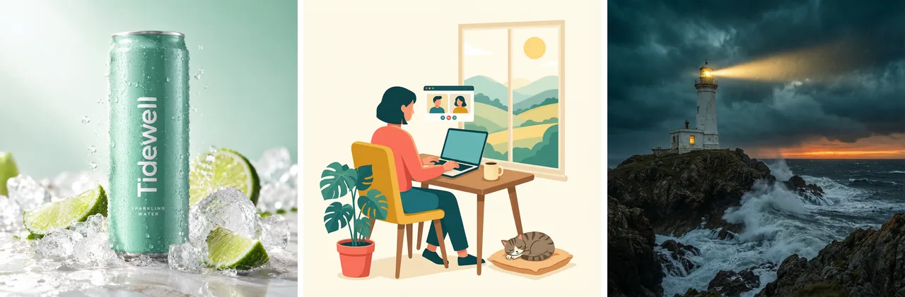

# AI Media Generator Skill

[English](./README.md) | 简体中文 | [日本語](./README.ja.md)

> 👉 也看看 [AI Image Generator Skill](https://github.com/beatra-ai/ai-image-generator-skill)

一个 Agent Skill 生成 AI 图片、视频、音乐和配音，支持 Claude Code、Cursor、Codex、Windsurf、Cline 和 OpenClaw。

> [!IMPORTANT]
> 生成需要 [Beatra](https://beatra.ai?utm_source=github&utm_medium=flagship&utm_campaign=ai-media-generator-skill) 账号并消耗积分，安装本身不收费。

| 问题 | 回答 |
| --- | --- |
| **能做什么** | 通过同一连接生成AI图片、视频、音乐与语音，查找公开社交数据，编辑受支持的图片和视频，并清晰查看返回文件与实际积分用量。 |
| **底层模型** | Qwen Image 2.0 Fast、Qwen Image 3.0、Qwen Image 3.0 Pro、GPT Image 2.5 Flare、GPT Image 2.5 Sunburst、GPT Image 2、Wan Image 2.7 Fast、Qwen Image 2.0 Pro、Wan Image 2.7 Pro、MiniMax Image 01 Live、MiniMax M3、Seedance 2.0 Mini、Wan 2.7、Wan 3.0 Video、MiniMax H3、HappyHorse 1.1、Seedance 2.0 Fast、Seedance 2.0、Wan 3.0 Video Prime、Seedance 2.5、Wan 2.7 Video Edit、HappyHorse 1.0 Video Edit、Suno 6、MiniMax Music 3.0、MiniMax Speech 2.8 HD、MiniMax Speech 2.8 Turbo、MiniMax Voice Clone |
| **运行要求** | Python 3.10+，以及能加载 `SKILL.md` 的 Agent |
| **费用** | 安装免费。每次生成消耗 Beatra 账号积分，只有你明确要求这次生成或批准确认卡后才会付费。 |
| **支持的 Agent** | Claude Code、Cursor、Codex、Windsurf、Cline、OpenClaw |

<p align="center"></p>

*同一个 Agent 会话里的三类图片任务：虚构气泡水品牌 Tidewell 的产品广告图、居家远程办公主题的扁平插画博客头图、暴风雨黄昏中的灯塔电影感概念图。由 Beatra AI 生成。*

| Skill | Entry point | Version |
| --- | --- | --- |
| [`beatra`](skills/beatra) | [SKILL.md](skills/beatra/SKILL.md) | 2.9.9 |

本仓库由 [beatra-ai/beatra-skills](https://github.com/beatra-ai/beatra-skills/tree/main/skills/beatra) 自动发布，问题请到那里反馈。

## 安装

使用 [`skills`](https://skills.sh) CLI：

```bash
npx skills add beatra-ai/ai-media-generator-skill
```

使用 GitHub CLI：

```bash
gh skill install beatra-ai/ai-media-generator-skill beatra
```

也可以克隆本仓库，把 `skills/beatra` 复制到 `~/.claude/skills/`（Claude Code）、`~/.cursor/skills/`（Cursor）、`~/.agents/skills/`（Codex）、`~/.codeium/windsurf/skills/`（Windsurf）、`~/.cline/skills/`（Cline）或 `~/.openclaw/skills/`（OpenClaw）。

或者把下面这段话发给你的 Agent：

```text
从 https://github.com/beatra-ai/ai-media-generator-skill 安装 beatra skill（目录 skills/beatra），然后按它的 SKILL.md 连接我的 Beatra 账号。
```

## 技术规格与输出限制

截至 2026-10-18。实时列表：https://docs.beatra.ai/zh/docs/models

- **上传** — 单个文件最大 100 MB；同时适用下方各模型的输入限制
- **文生图** — 10 个模型（Qwen Image 2.0 Fast、Qwen Image 3.0、Qwen Image 3.0 Pro、GPT Image 2.5 Flare、GPT Image 2.5 Sunburst、GPT Image 2、Wan Image 2.7 Fast、Qwen Image 2.0 Pro、Wan Image 2.7 Pro、MiniMax Image 01 Live）；PNG；单次最多 4 张；画布最大 16.8 MP
  - 16.8 MP（4K 档）：Wan Image 2.7 Pro（单次最多 4 张）；GPT Image 2.5 Flare、GPT Image 2.5 Sunburst、GPT Image 2（单次 1 张）
- **图生图** — 10 个模型（Qwen Image 2.0 Fast、Qwen Image 3.0、Qwen Image 3.0 Pro、Wan Image 2.7 Fast、Qwen Image 2.0 Pro、Wan Image 2.7 Pro、GPT Image 2.5 Flare、GPT Image 2.5 Sunburst、GPT Image 2、MiniMax Image 01 Live）；PNG；单次最多 4 张；画布最大 16.8 MP
  - 16.8 MP（4K 档）：GPT Image 2.5 Flare、GPT Image 2.5 Sunburst、GPT Image 2（单次 1 张）
  - 输入图片：单次最多 4 张，每张 10–20 MB；BMP、GIF、JPEG、PNG、TIFF、WEBP
- **图片编辑** — 6 个模型（Qwen Image 2.0 Fast、Qwen Image 3.0、Qwen Image 3.0 Pro、Wan Image 2.7 Fast、Qwen Image 2.0 Pro、Wan Image 2.7 Pro）；PNG；单次最多 4 张；画布最大 4.2 MP
  - 4.2 MP（2K 档）：Qwen Image 2.0 Fast、Qwen Image 3.0、Qwen Image 3.0 Pro、Wan Image 2.7 Fast、Qwen Image 2.0 Pro、Wan Image 2.7 Pro（单次最多 4 张）
  - 输入图片：单次最多 4 张，每张 10–20 MB；BMP、GIF、JPEG、PNG、TIFF、WEBP
- **图片理解** — 1 个模型（MiniMax M3）；单次最多 8 个文件；每个最大 10 MB
- **文生视频** — 9 个模型（Seedance 2.0 Mini、Wan 2.7、Wan 3.0 Video、MiniMax H3、HappyHorse 1.1、Seedance 2.0 Fast、Seedance 2.0、Wan 3.0 Video Prime、Seedance 2.5）；480p 至 4K；2–30 秒；画幅 16:9、1:1、21:9、3:4、4:3、9:16、4:5、5:4、9:21；MOV、MP4
  - 4K：Seedance 2.0，最长 15 秒
  - 30 秒：Wan 3.0 Video、Wan 3.0 Video Prime、Seedance 2.5，最高 1080p
  - 原生音频：Wan 2.7、MiniMax H3
- **图生视频** — 9 个模型（Wan 2.7、Wan 3.0 Video、MiniMax H3、Seedance 2.0 Mini、HappyHorse 1.1、Seedance 2.0 Fast、Seedance 2.0、Wan 3.0 Video Prime、Seedance 2.5）；480p 至 4K；2–30 秒；画幅 16:9、1:1、21:9、3:4、4:3、9:16；MOV、MP4
  - 4K：Seedance 2.0，最长 15 秒
  - 30 秒：Wan 3.0 Video、Wan 3.0 Video Prime、Seedance 2.5，最高 1080p
  - 原生音频：Wan 2.7、MiniMax H3
- **参考生视频** — 9 个模型（Wan 2.7、MiniMax H3、Wan 3.0 Video、HappyHorse 1.1、Seedance 2.0 Mini、Seedance 2.0 Fast、Seedance 2.0、Wan 3.0 Video Prime、Seedance 2.5）；480p 至 4K；2–30 秒；画幅 16:9、1:1、3:4、4:3、9:16、21:9、4:5、5:4、9:21；MOV、MP4
  - 4K：Seedance 2.0，最长 15 秒
  - 30 秒：Wan 3.0 Video、Wan 3.0 Video Prime、Seedance 2.5，最高 1080p
  - 原生音频：Wan 2.7、MiniMax H3
- **首尾帧生视频** — 8 个模型（Wan 2.7、Wan 3.0 Video、MiniMax H3、Seedance 2.0 Mini、Seedance 2.0 Fast、Seedance 2.0、Wan 3.0 Video Prime、Seedance 2.5）；480p 至 4K；2–30 秒；画幅 16:9、1:1、21:9、3:4、4:3、9:16；MOV、MP4
  - 4K：Seedance 2.0，最长 15 秒
  - 30 秒：Wan 3.0 Video、Wan 3.0 Video Prime、Seedance 2.5，最高 1080p
  - 原生音频：Wan 2.7、MiniMax H3
- **视频编辑** — 8 个模型（Wan 2.7 Video Edit、Wan 3.0 Video、HappyHorse 1.0 Video Edit、Seedance 2.0 Mini、Seedance 2.0 Fast、Seedance 2.0、Wan 3.0 Video Prime、Seedance 2.5）；480p 至 4K；2–30 秒；画幅 16:9、1:1、3:4、4:3、9:16、21:9；MOV、MP4
  - 4K：Seedance 2.0，最长 15 秒
  - 30 秒：Wan 3.0 Video、Wan 3.0 Video Prime、Seedance 2.5，最高 1080p
- **视频延长** — 7 个模型（Wan 2.7、Wan 3.0 Video、Seedance 2.0 Mini、Seedance 2.0 Fast、Seedance 2.0、Wan 3.0 Video Prime、Seedance 2.5）；480p 至 4K；2–30 秒；画幅 16:9、1:1、21:9、3:4、4:3、9:16；MOV、MP4
  - 4K：Seedance 2.0，最长 15 秒
  - 30 秒：Wan 3.0 Video、Wan 3.0 Video Prime、Seedance 2.5，最高 1080p
  - 原生音频：Wan 2.7
- **视频理解** — 1 个模型（MiniMax M3）；单次 1 个文件；每个最大 50 MB；最长 360 秒；按 1 fps 抽帧
- **文生音乐** — 2 个模型（Suno 6、MiniMax Music 3.0）；MP3
  - Suno 6：提示词最多 500、歌词最多 5000、标题最多 80 字符
  - MiniMax Music 3.0：提示词最多 2000、歌词最多 3500、标题最多 100 字符
- **参考音频生音乐** — 2 个模型（Suno 6、MiniMax Music 3.0）；MP3
  - Suno 6：提示词最多 500、歌词最多 5000、标题最多 80 字符；参考音频 6–480 秒（FLAC、MP3、WAV）
  - MiniMax Music 3.0：提示词最多 300、歌词最多 1000、标题最多 100 字符；参考音频 6–360 秒，最大 50 MB（FLAC、MP3、WAV）
- **语音合成** — 2 个模型（MiniMax Speech 2.8 HD、MiniMax Speech 2.8 Turbo）；FLAC、MP3、OPUS、PCM、WAV；40 种语言；采样率 8、16、22.05、24、32、44.1 kHz；单次最多 50000 字符
  - 语言（ISO 639 代码）：zh, yue, en, es, fr, ru, de, pt, ar, it, ja, ko, id, vi, tr, nl, uk, th, pl, ro, el, cs, fi, hi, bg, da, he, ms, fa, sk, sv, hr, fil, hu, no, sl, ca, nn, ta, af
- **声音克隆** — 1 个模型（MiniMax Voice Clone）；样本 10–300 秒，最大 20 MB；需提交授权声明

## 为什么用 Beatra，而不是直接调用模型 API

- **一个账号用到本 skill 的全部模型** — 文生图 10；图生图 10；图片编辑 6；图片理解 1；文生视频 9；图生视频 9；参考生视频 9；首尾帧生视频 8；视频编辑 8；视频延长 7；视频理解 1；文生音乐 2；参考音频生音乐 2；语音合成 2；声音克隆 1（Qwen Image 2.0 Fast、Qwen Image 3.0、Qwen Image 3.0 Pro、GPT Image 2.5 Flare、GPT Image 2.5 Sunburst、GPT Image 2、Wan Image 2.7 Fast、Qwen Image 2.0 Pro、Wan Image 2.7 Pro、MiniMax Image 01 Live、MiniMax M3、Seedance 2.0 Mini、Wan 2.7、Wan 3.0 Video、MiniMax H3、HappyHorse 1.1、Seedance 2.0 Fast、Seedance 2.0、Wan 3.0 Video Prime、Seedance 2.5、Wan 2.7 Video Edit、HappyHorse 1.0 Video Edit、Suno 6、MiniMax Music 3.0、MiniMax Speech 2.8 HD、MiniMax Speech 2.8 Turbo、MiniMax Voice Clone）（截至 2026-10-18），一次 Beatra 登录即可使用，不必分别管理各家模型的 key。
- **花不花钱由你决定** — 只有你明确要求这次生成，或批准显示实时积分估算的确认卡后才会付费。
- **先策划，再生成** — skill 先帮你规划、指导和检查，再在 Beatra 上生成。
- **文件可以核验** — `skills/` 下的每个文件都与 cdn.beatra.ai 上的发布归档逐字节一致，每次推送前用 SHA-256 校验。
- **更新由你掌控** — 不含自更新程序；用安装时的工具更新。
- **在你的 Agent 里运行** — Claude Code、Cursor、Codex、Windsurf、Cline、OpenClaw。

## 与同类方案对比

| | Beatra（本 skill） | [ZeroLu/Ultimate-AI-Media-Generator-Skill](https://github.com/ZeroLu/Ultimate-AI-Media-Generator-Skill) | [scenario-labs/skills](https://github.com/scenario-labs/skills) | [vargHQ/skills](https://github.com/vargHQ/skills) |
| --- | --- | --- | --- | --- |
| 需要的账号或 key | 一个 Beatra 账号，不需要各家模型的 key | CyberBara API key，保存在 ~/.config/cyberbara/api_key（[出处](https://github.com/ZeroLu/Ultimate-AI-Media-Generator-Skill/blob/f28e58f2b9814b2056417377c46f34fd35219702/README.md#L68-L76)） | Scenario 账号（OAuth 登录）或 Scenario API key（[出处](https://github.com/scenario-labs/skills/blob/49dd26e47371163ae0020c7f5627d0993626bfc2/README.md#L105)） | VARG_API_KEY，所有 skill 都需要（[出处](https://github.com/vargHQ/skills/blob/862c0297ba2063b10eeb5d4d1058b0f90dc9f92d/README.md#L70)） |
| 模型 | 文生图 10；图生图 10；图片编辑 6；图片理解 1；文生视频 9；图生视频 9；参考生视频 9；首尾帧生视频 8；视频编辑 8；视频延长 7；视频理解 1；文生音乐 2；参考音频生音乐 2；语音合成 2；声音克隆 1（Qwen Image 2.0 Fast、Qwen Image 3.0、Qwen Image 3.0 Pro、GPT Image 2.5 Flare、GPT Image 2.5 Sunburst、GPT Image 2、Wan Image 2.7 Fast、Qwen Image 2.0 Pro、Wan Image 2.7 Pro、MiniMax Image 01 Live、MiniMax M3、Seedance 2.0 Mini、Wan 2.7、Wan 3.0 Video、MiniMax H3、HappyHorse 1.1、Seedance 2.0 Fast、Seedance 2.0、Wan 3.0 Video Prime、Seedance 2.5、Wan 2.7 Video Edit、HappyHorse 1.0 Video Edit、Suno 6、MiniMax Music 3.0、MiniMax Speech 2.8 HD、MiniMax Speech 2.8 Turbo、MiniMax Voice Clone） | CyberBara 上的模型：Nano Banana 2、GPT Image 2、Midjourney v7、Seedream 5 Pro、Sora 2、Seedance 2.5、Kling、Veo 3.1、MiniMax H3、Suno（[出处](https://github.com/ZeroLu/Ultimate-AI-Media-Generator-Skill/blob/f28e58f2b9814b2056417377c46f34fd35219702/README.md#L172-L207)） | Scenario 上的图片、视频、音频和 3D 模型，如 GPT Image、Seedream、Veo、Kling、Seedance、ElevenLabs、MiniMax 音乐（[出处](https://github.com/scenario-labs/skills/blob/49dd26e47371163ae0020c7f5627d0993626bfc2/README.md#L247-L299)） | 通过 varg 平台使用 Kling、Flux、ElevenLabs、Sora 等模型（[出处](https://github.com/vargHQ/skills/blob/862c0297ba2063b10eeb5d4d1058b0f90dc9f92d/README.md#L3)） |
| 花钱前 | 只有你明确要求这次生成，或批准显示实时积分估算的确认卡后才会付费 | 提交前可用 `quote` 命令查询 `estimated_credits` 和 `can_afford`（[出处](https://github.com/ZeroLu/Ultimate-AI-Media-Generator-Skill/blob/f28e58f2b9814b2056417377c46f34fd35219702/README.md#L105-L115)） | 质量检查和模型对比两个 skill 可先 dry-run 试算价格（[出处](https://github.com/scenario-labs/skills/blob/49dd26e47371163ae0020c7f5627d0993626bfc2/README.md#L208-L210)） | 完整渲染前可先用 `--preview` 免费预览（[出处](https://github.com/vargHQ/skills/blob/862c0297ba2063b10eeb5d4d1058b0f90dc9f92d/README.md#L158-L160)） |
| 支持的 Agent | Claude Code、Cursor、Codex、Windsurf、Cline、OpenClaw | OpenClaw、Claude Code、Codex、Claude Cowork、Cursor、Antigravity（[出处](https://github.com/ZeroLu/Ultimate-AI-Media-Generator-Skill/blob/f28e58f2b9814b2056417377c46f34fd35219702/README.md#L31-L36)） | Claude Code、Cursor、Codex、Copilot 及另外 70 多种编程 Agent（[出处](https://github.com/scenario-labs/skills/blob/49dd26e47371163ae0020c7f5627d0993626bfc2/README.md#L30)） | Claude Code、Cursor、Windsurf、OpenCode、ClawHub 以及任何支持 Agent Skills 的工具（[出处](https://github.com/vargHQ/skills/blob/862c0297ba2063b10eeb5d4d1058b0f90dc9f92d/README.md#L10)） |
| 安装 | `npx skills add beatra-ai/ai-media-generator-skill` | `npx skills add ZeroLu/Ultimate-AI-Media-Generator-Skill --all`（[出处](https://github.com/ZeroLu/Ultimate-AI-Media-Generator-Skill/blob/f28e58f2b9814b2056417377c46f34fd35219702/README.md#L60)） | `npx skills add scenario-labs/skills`，再连接 Scenario MCP 服务器（https://mcp.scenario.com/mcp）（[出处](https://github.com/scenario-labs/skills/blob/49dd26e47371163ae0020c7f5627d0993626bfc2/README.md#L89-L105)） | `npx skills add vargHQ/skills`（[出处](https://github.com/vargHQ/skills/blob/862c0297ba2063b10eeb5d4d1058b0f90dc9f92d/README.md#L59)） |
| 许可证 | MIT-0 | MIT（[出处](https://github.com/ZeroLu/Ultimate-AI-Media-Generator-Skill/blob/f28e58f2b9814b2056417377c46f34fd35219702/LICENSE)） | MIT（[出处](https://github.com/scenario-labs/skills/blob/49dd26e47371163ae0020c7f5627d0993626bfc2/LICENSE)） | MIT（[出处](https://github.com/vargHQ/skills/blob/862c0297ba2063b10eeb5d4d1058b0f90dc9f92d/LICENSE)） |
| 最近更新 | 随每次发布更新（v2.9.9） | 2026-09-08（[出处](https://github.com/ZeroLu/Ultimate-AI-Media-Generator-Skill/commit/f28e58f2b9814b2056417377c46f34fd35219702)） | 2026-10-15（[出处](https://github.com/scenario-labs/skills/commit/49dd26e47371163ae0020c7f5627d0993626bfc2)） | 2026-10-01（[出处](https://github.com/vargHQ/skills/commit/862c0297ba2063b10eeb5d4d1058b0f90dc9f92d)） |

事实核对于 2026-10-16。有误请到 [beatra-ai/beatra-skills](https://github.com/beatra-ai/beatra-skills/issues) 提 issue。


## 更新与安全

自 2026 年 10 月的版本起，本 skill 不再包含自更新程序：它只运行你安装的文件，从不自行替换。
请用安装时的工具更新——`npx skills update beatra` 或 `gh skill update beatra`。
详见 skill 内的 `references/updates-and-security.md`。

## 许可证

[MIT-0](LICENSE)：可自由使用、修改和再分发，包括商用，无需署名；与这些 skill 在 ClawHub 上的条款一致。

## 相关链接

- 官网 — https://www.beatra.cn?utm_source=github&utm_medium=flagship&utm_campaign=ai-media-generator-skill
- 文档 — https://docs.beatra.cn?utm_source=github&utm_medium=flagship&utm_campaign=ai-media-generator-skill
- 控制台 — https://console.beatra.cn
- 给 AI Agent 读的说明 — https://www.beatra.cn/llms.txt （索引）· https://www.beatra.cn/llms-full.txt （全部 skill 合成一个文件）

- 微信小程序 — 国内用户微信扫码使用


